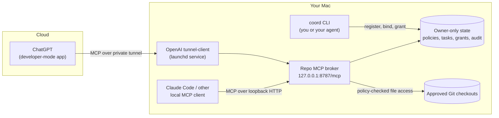

# Repo MCP

**Give ChatGPT and Claude safe, scoped access to the Git repositories on your Mac.**

Repo MCP is a local [Model Context Protocol](https://modelcontextprotocol.io) server.
It lets an AI client read, search, review and (when you allow it) edit code in Git
checkouts that you approve. You decide which repositories it can see, which paths it
can touch, and when it may write. Everything else stays on your machine.

- **One service, many repositories.** Install it once. Register any number of checkouts.
  Different chats can work in different repositories at the same time.
- **Read-only by default.** Every chat must open a workspace first. Review and inspect
  workspaces cannot write. A coding workspace needs a short-lived grant that you issue.
- **Policy per repository.** Each repository has a JSON policy with read, write and
  create scopes. Secrets, `.git`, dotfiles and build output are blocked unless you opt in.
- **No Git push, no shell by default.** The model cannot commit or push. It cannot run
  commands, unless you issue a code grant with `--exec`. Then it gets an owner-level
  shell with no sandbox (see [Tools](#tools)). Commit and push stay with you.
- **No model API calls.** Repo MCP does not call any model API. It only serves tools.
- **Agent-installable.** Open this repository in Claude Code or Codex and ask it to set
  up Repo MCP. The bundled skills do the work.

> **Status: v0.3.0, unreleased `main` after the v0.2.3 tag. Early release, macOS only.**
> It is tested on the maintainer's Mac (v0.2.3: 577 tests pass, 1 optional skip). A first
> install on a clean Mac is not yet proven. Linux and Windows are not supported.
> See [Status and limits](#status-and-limits). New in 0.3: [What's new](docs/WHATS-NEW-0.3.md).

## Who is it for

- You use **ChatGPT** and want it to read or review a local repository without uploading
  a zip or pasting files.
- You use **Claude Code** or **Codex** locally and want a second, independent model to
  review a change against the same repository.
- You want this access to be **narrow, auditable and revocable**, not a full shell.

## How it works



1. **You register a repository** with the local `coord` CLI and give it a policy.
2. **You bind a task** to that repository. A task has a phase: coding or review.
3. **The model opens a workspace.** It calls `workspace_open` with the repository and task
   IDs. Repo MCP returns a signed `workspace_token` that is bound to that repository,
   task, policy and mode.
4. **The model works through the token.** Every repository tool requires the token.
   There is no "current repository", so two chats cannot cross over by accident.
5. **You keep control.** Phase changes, rebinds and revocations invalidate old tokens.
   Commits, pushes and real builds stay outside MCP.

ChatGPT reaches the local server through the official
[OpenAI tunnel client](https://github.com/openai/tunnel-client)
([Secure MCP tunnels guide](https://developers.openai.com/api/docs/guides/secure-mcp-tunnels)).
The loopback port is never exposed to the internet. Claude Code connects to the
loopback URL directly and needs no tunnel.

Read [docs/HOW-IT-WORKS.md](docs/HOW-IT-WORKS.md) for the full model: workspaces,
modes, grants, epochs and the review flow.

## Tools

The server exposes sixteen tools with fixed schemas.

| Group | Tools | Notes |
| --- | --- | --- |
| Bootstrap | `service_info`, `repository_list`, `workspace_open`, `workspace_close` | Discover what is registered and open a scoped workspace. |
| Read | `repo_info`, `list_files`, `search`, `read`, `git_diff` | Paged and size-bounded. Need a `workspace_token`. |
| Write | `edit`, `create_file` | Coding workspaces only. Stale-hash and no-overwrite checks. |
| Check | `run_tests` | Only operator-approved fixture suites. No arbitrary commands. |
| Report | `finish` | Delivers the final report once per workspace (review: ship or no-ship; inspect and code: completed). Immutable, 192 KiB at most. |
| Shell | `exec`, `exec_poll`, `exec_cancel` | Code workspaces whose grant was issued with `--exec` only. See below. |

Workspace modes:

| Mode | Can read | Can write | Needs |
| --- | --- | --- | --- |
| `inspect` | yes | no | a registered repository and task |
| `review` | yes | no | a task in review phase |
| `code` | yes | yes, within policy | a single-use write grant (10 minutes) from `coord workspace grant` |

The `exec` tools run `/bin/sh -c` in the checkout as you. There is **no sandbox** and no
extra worktree. A command can escape its process group. Use `--exec` only for repositories
and prompts you trust. Each workspace runs one command at a time (10 minutes by default,
30 at most). Logs are limited to 4 MiB and token-redacted. Every command is audited, and
Repo MCP cancels it when the workspace closes, is revoked, expires or the service stops.
Details: [docs/EXEC-TOOL.md](docs/EXEC-TOOL.md).

## Let an agent run ChatGPT for you (`go`)

A coordinator agent (Claude Code or Codex) starts one command:

```bash
npm run --silent chatgpt-run -- go --request-id ID --repository REPO --task TASK --coordinator claude --kind review --prompt-file prompt.txt
```

Then `go` does the rest. ChatGPT does the work. Nobody pastes anything.

1. It opens its own tab in your **main, signed-in Chrome** over the Chrome DevTools
   Protocol, through a local relay.
2. It attaches Repo MCP, enters the prompt, selects the effort and sends once.
3. It waits in code, saves the answer and cleans up. For a review it closes the
   participant. For code it revokes the write grant and runs your `--check` commands.
   Then it archives the chat.
4. It prints one JSON line. Exit 0 means cleaned. Exit 3 means the prompt may have been
   sent, so only `--resume` is allowed. Exit 1 means failed.

The kinds are `architecture`, `review` (commit-pinned only) and `code`. For code, `go`
issues the single-use write grant itself and never writes it to a prompt file. Add
`--exec` to let that grant enable the `exec` tools. `go` never commits. ChatGPT delivers
its final report through `finish`, and `go` uses that report as the run output.

**Prerequisites.**

- The main Chrome must be running and signed in to ChatGPT. `go` never starts Chrome and
  never signs in.
- Switch on remote debugging in `chrome://inspect/#remote-debugging`. Chrome asks you to
  approve the relay once per Chrome start.
- One unresolved ChatGPT run per machine, and at most four sends per hour by default.

**Limits and honest numbers.**

- Measurement 1 compared one review. The coordinator used 68,576 tokens through `go` and
  141,710 tokens directly. That is about 52% less, and the comparison is not equal: the
  direct run used Sonnet at default effort, and `go` used ChatGPT at Extra High. Treat 52%
  as a floor from one task. A saving of 80 to 90% is not shown.
- ChatGPT UI changes can break the selectors. Then `go` fails before it sends (`UI_*`
  codes). `chatgpt-run probe` checks the page read-only.
- Whether automating the consumer ChatGPT web UI is acceptable under the service terms is
  an open decision of the maintainer. This project does not claim it is resolved.

See [docs/GO-DRIVER-SPEC.md](docs/GO-DRIVER-SPEC.md). The manual recipes in
[docs/REVIEW-MANUAL-RECIPE.md](docs/REVIEW-MANUAL-RECIPE.md),
[docs/ARCHITECT-MANUAL-RECIPE.md](docs/ARCHITECT-MANUAL-RECIPE.md) and
[docs/CODING-MANUAL-RECIPE.md](docs/CODING-MANUAL-RECIPE.md) remain as fallback.

## Install

### Option 1: let your agent do it (recommended)

Clone the repository and open it in Claude Code or Codex:

```bash
git clone https://github.com/jazzyalex/repo-mcp.git
```

Then say:

> Use the Repo MCP skill in this repository to install Repo MCP and verify Claude Code and ChatGPT access.

The agent follows [CLAUDE.md](CLAUDE.md) or [AGENTS.md](AGENTS.md). It checks
prerequisites, runs the tests, installs the broker as a launchd service, registers the
MCP server with Claude Code, installs the Repo MCP skills globally, and runs an
end-to-end smoke test against a disposable fixture repository
(`repo-mcp-onboarding`, task `repo-mcp-onboarding-smoke`).

The agent asks you only for steps that need your accounts:

- creating the private OpenAI tunnel and a runtime key with **Tunnels Read + Use**
  (you type the key into a hidden local prompt, never into chat);
- adding or refreshing the Repo MCP app in ChatGPT developer mode.

Later, in any other project, say:

> Use the Repo MCP skill to connect this repository for read-only review.

The agent runs `coord repository resolve`, creates a narrow policy, registers the
checkout and binds a task. You never handle repository IDs, task IDs or tokens.

### Option 2: manual

Requirements: macOS, Python 3.9+, Node 26+, npm, Git at `/usr/bin/git`. For ChatGPT
you also need the OpenAI tunnel client and an OpenAI Platform organization with tunnel
access. Claude Code alone needs no tunnel.

```bash
python3 scripts/check-prerequisites.py
```

```bash
npm ci && npm run build && npm test
```

```bash
python3 scripts/install-server-service.py --install
```

```bash
npm run coord -- service configure --port 8787 && npm run coord -- service start
```

```bash
claude mcp add --scope user --transport http repo-mcp http://127.0.0.1:8787/mcp
```

Then follow [SETUP.md](SETUP.md) to create the tunnel, connect ChatGPT, register your
first repository and run the smoke test.

## Use it

Register a repository with a read-only policy (your agent normally does this for you):

```bash
mkdir -p ~/Library/Application\ Support/repo-mcp/policies && cp docs/policy-readonly.json ~/Library/Application\ Support/repo-mcp/policies/my-app.json
```

```bash
npm run coord -- repository add --repository my-app --repo ~/code/my-app --policy ~/Library/Application\ Support/repo-mcp/policies/my-app.json
```

```bash
npm run coord -- task bind --repository my-app --task my-app-review
```

Then, in ChatGPT with the Repo MCP app enabled, ask:

> Use Repo MCP. Open an inspect workspace for repository `my-app`, task `my-app-review`, and explain how authentication works in this codebase.

Policy templates: [read-only](docs/policy-readonly.json) and
[bounded coding](docs/policy-coding.json).

## Safety model

Repo MCP reduces accidental scope expansion. It is **not** a sandbox for hostile code.

- Policies are deny-first. Denials always win.
- Path checks block traversal, symlinks, hard links, VCS metadata, server state and
  common secret file names: `.env*`, private keys, `secrets.yml`, service-account JSON,
  `*.tfstate`, `*.tfvars`, kubeconfig and similar.
- Untracked files that Git ignores (`.gitignore`, `.git/info/exclude`, a repository-local
  `core.excludesFile`; not your global excludes) are hidden from listing, reading and
  search. Local config, state and build output usually live there. Tracked files stay visible even if
  they match `.gitignore`. The filename denylist is still a safety net, not a guarantee:
  add anything else private to `read.exclude`.
- Read access is not authenticated per user. Any client that can reach the endpoint
  can open `inspect` workspaces on enabled repositories. Only writes need your grant.
  Disable repositories you are not using.
- Edits require the current file hash, so a model cannot overwrite a file it has not read.
- Mutations carry a request ID and a durable outcome, so retries do not apply twice.
- Workspace tokens are bearer tokens. They are signed with an owner-only local key and
  bound to repository, task, policy and mode. They are not proof of which chat holds them.
- Repository content can contain prompt injection. Prefer `inspect` and `review`
  workspaces. Give coding grants only for work you will review before you commit.
- Never expose the loopback port directly. Use the private tunnel.

See [SECURITY.md](SECURITY.md) for the threat model and how to report a vulnerability.

## Status and limits

- **Platform:** macOS only (launchd). Linux and Windows are not supported yet.
- **Validated:** build, typecheck and the full test suite on an existing installation;
  a deployed Claude Code to ChatGPT commit-pinned review smoke test; the first live
  `go --kind code` run (0.3.0 development).
- **Go driver:** needs the main Chrome with remote debugging, on macOS only. It is
  sensitive to ChatGPT UI changes. The saving measured so far is about 52% on one task.
- **Not yet proven:** first install on a clean Mac, new tunnel credentials, and first
  ChatGPT app registration.
- **ChatGPT access:** developer mode, custom MCP apps and write actions depend on your
  ChatGPT plan and workspace settings. Check OpenAI's current documentation.
- **Clients:** ChatGPT (through the tunnel) and Claude Code, including the Code tab of
  the Claude desktop app (through loopback HTTP). Claude Desktop chat and claude.ai
  connectors cannot reach a loopback server, and Repo MCP has no stdio mode yet.
- **Coding through ChatGPT** can be coordinated by Codex or Claude Code. In both
  cases ChatGPT makes the edits through a `code` workspace and a single-use write grant.
  The coordinator starts `go --kind code`.
- **After a tool change:** run `npm run build`, restart with
  `npm run coord -- service start`, then click "Refresh tools" for Repo MCP in ChatGPT
  Settings > Plugins. Otherwise ChatGPT keeps the old tool list.

## Documentation

| Document | Contents |
| --- | --- |
| [docs/WHATS-NEW-0.3.md](docs/WHATS-NEW-0.3.md) | What changed in 0.3: `go`, `finish`, `exec` |
| [docs/HOW-IT-WORKS.md](docs/HOW-IT-WORKS.md) | Architecture, authority model, review flow |
| [SETUP.md](SETUP.md) | Full installation, tunnel, ChatGPT connection, troubleshooting |
| [docs/OPERATIONS.md](docs/OPERATIONS.md) | Operator reference: tasks, grants, review workflow, locks, GC, migration |
| [SECURITY.md](SECURITY.md) | Threat model and vulnerability reporting |
| [docs/MULTI-REPO-SPEC.md](docs/MULTI-REPO-SPEC.md) | Normative v0.2 authority and lifecycle contract |
| [docs/SHARED-REVIEW-WORKFLOW.md](docs/SHARED-REVIEW-WORKFLOW.md) | Coordinator protocol for shared reviews |
| [docs/GO-DRIVER-SPEC.md](docs/GO-DRIVER-SPEC.md) | The `go` run driver and the Chrome relay |
| [docs/EXEC-TOOL.md](docs/EXEC-TOOL.md) | The opt-in `exec` tools and their trust model |

## Disclaimer

Repo MCP is an independent open-source project. It is not affiliated with, endorsed by
or sponsored by OpenAI or Anthropic. ChatGPT, Codex and OpenAI are trademarks of OpenAI.
Claude and Claude Code are trademarks of Anthropic. You are responsible for following
the terms of every service you connect to Repo MCP.

## License

[MIT](LICENSE)
