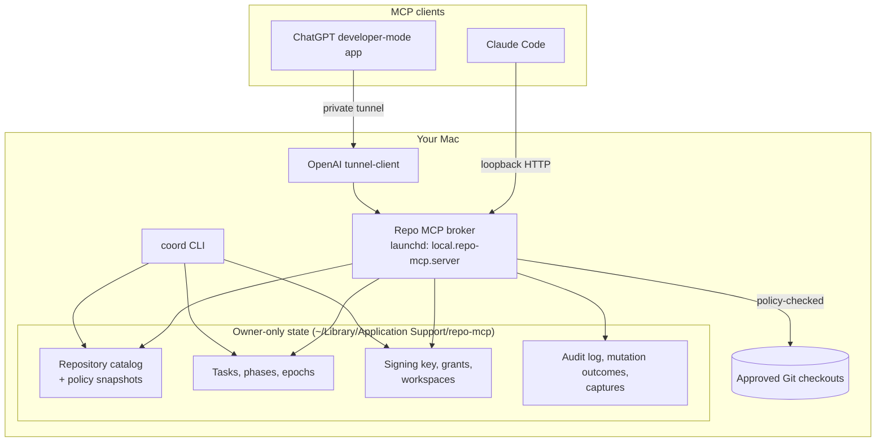
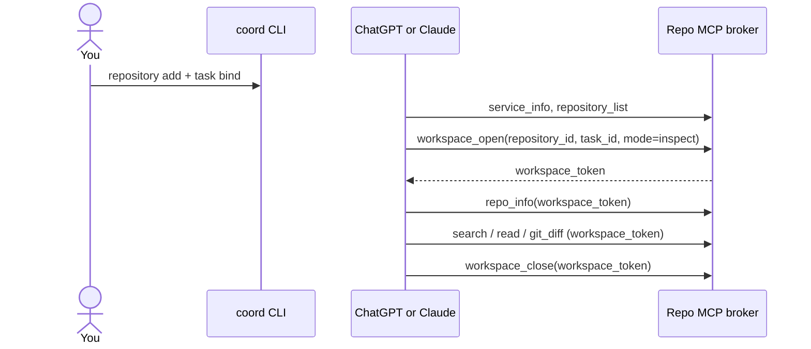

# How Repo MCP works

This page explains the moving parts of Repo MCP and why they exist. For installation,
read [SETUP.md](../SETUP.md). For the normative contract, read
[MULTI-REPO-SPEC.md](MULTI-REPO-SPEC.md).

## The problem

AI clients are good at reading and reviewing code. But giving a cloud chat access to a
local repository usually means one of two bad options:

- copy files into the chat by hand, which is slow and loses context; or
- give an agent a shell, which gives it far more power than a review needs.

Repo MCP is a middle path. It gives the model a small set of file and Git tools. Each
tool call is checked against a repository you approved, a task you started and a policy
you wrote.

## Components

| Component | Role |
| --- | --- |
| **Broker** | A permanent Node.js MCP server on the loopback interface. It serves the twelve tools. It starts with an empty catalog and never needs a restart to switch repositories. |
| **coord CLI** | The operator console. It registers repositories, binds tasks, changes phases, issues write grants and recovers locks. Only you, or an agent you run locally, use it. The model never sees it. |
| **Tunnel client** | OpenAI's official client. It opens an authenticated outbound connection so ChatGPT can reach the loopback broker. Nothing listens on a public port. |
| **State directory** | Owner-only files outside every served repository: policy snapshots, task records, the token signing key, grants, audit logs and request outcomes. |

## Authority in four layers

Every repository tool call must pass all four layers. A mismatch at any layer fails
closed.

1. **Service.** The broker is running and its tool schemas are fixed.
2. **Repository registration.** You approved this checkout with `coord repository add`.
   Repo MCP copies the policy into its own state, so later edits to the source policy
   file do nothing until you register again. Each registration has an epoch.
3. **Task.** You bound a task to the checkout with `coord task bind`. The task records
   the branch, HEAD, policy digest and phase (coding or review). It has a binding epoch
   and a phase epoch. One unfinished task is allowed per checkout. For parallel work on
   one project, register separate Git worktrees.
4. **Workspace.** The model calls `workspace_open` with a repository ID, a task ID and a
   mode. Repo MCP returns a signed `workspace_token`. The token stores all three epochs.

When you disable a repository, change its policy, rebind a task or change its phase, the
matching epoch goes up. Every older token stops working. For example, a coding token
issued before a review cannot become writable again after you resume coding.

## A typical session

For coding, you first run `coord workspace grant --task TASK`. The grant is single-use
and expires in 10 minutes. The model passes it once to `workspace_open` with
`mode=code`. After that, `edit` and `create_file` work inside the policy's write and
create scopes. Each edit must include the file's current hash and a request ID, so a
stale or repeated write fails safely.

## Policies

A policy is a JSON file with read, write and create scopes, dotfile opt-ins, approved
test suites and resource limits. Exclusions always win. Two templates ship with the
project:

- [policy-readonly.json](policy-readonly.json): read everything except build output and
  private state; write nothing.
- [policy-coding.json](policy-coding.json): edit only `src/` and `test/`; no package
  files; no dependency installation.

Some protections apply under every policy: `.git` and VCS metadata, secret-like file
names, Repo MCP state, path traversal, symlinks and hard links.

Discovery also hides untracked files that Git ignores (the repository's `.gitignore`
files and `.git/info/exclude`). Repo MCP asks Git for this list on every call, so an
edited `.gitignore` takes effect at once. A tracked file stays visible even when it
matches an ignore rule. Policies made of exact file paths are not filtered: the operator
named each file.

## Reviews

A review task is a task in the review phase. A `review` workspace is read-only. Repo MCP
supports two review targets:

- **Working review:** compares the live checkout with a base commit.
- **Commit-pinned review:** binds an immutable base and head commit, with an optional
  path scope. The result reports a candidate digest for exactly that range. Use this when
  the branch may move during the review.

Several coordinators (for example Codex and Claude Code) can join one review of the
same target. Each one keeps its own participant, workspace and result.

The bundled skills also include a **coordinated ChatGPT review** flow. In this flow,
Claude Code or Codex prepares the review locally and records each step in a durable run
journal (`chatgpt-run`), while ChatGPT performs the review through Repo MCP. The skills
currently tell the local agent to operate the ChatGPT web page with its browser tools.
Check that this use fits the terms of the services you use before you enable it. The full
protocol is in [SHARED-REVIEW-WORKFLOW.md](SHARED-REVIEW-WORKFLOW.md).

## What Repo MCP does not do

- It does not run arbitrary commands. `run_tests` runs only fixture suites in the policy.
- It does not commit, push, install dependencies or change policies through MCP.
- It does not call any model API.
- It does not isolate hostile code. It assumes your user account, your repositories and
  your policies are trusted.
- It does not prove which chat holds a token. Tokens are bearer capabilities.

## Further reading

- [OPERATIONS.md](OPERATIONS.md): operator commands, locks, garbage collection, migration
- [SECURITY.md](../SECURITY.md): threat model and reporting
- [DESIGN-2B-PATH-POLICY.md](DESIGN-2B-PATH-POLICY.md): path policy design
