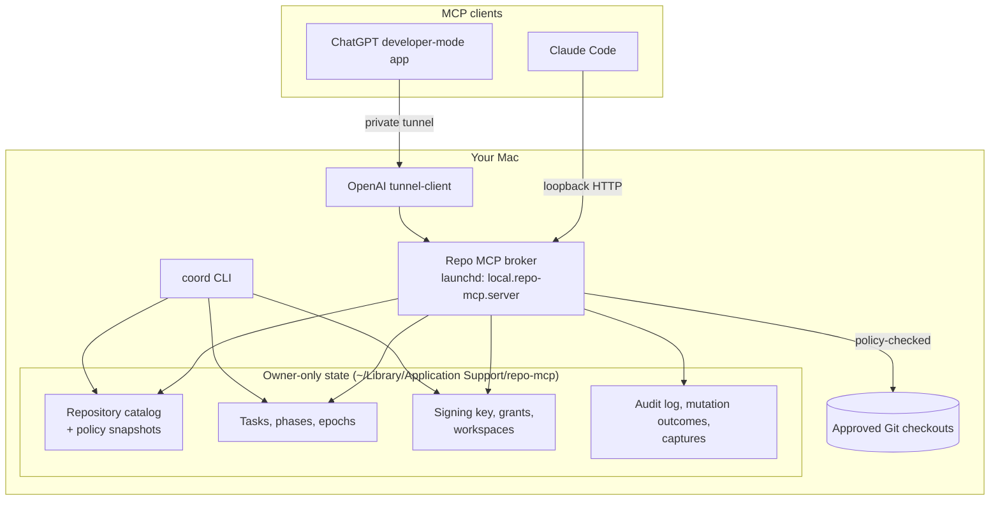
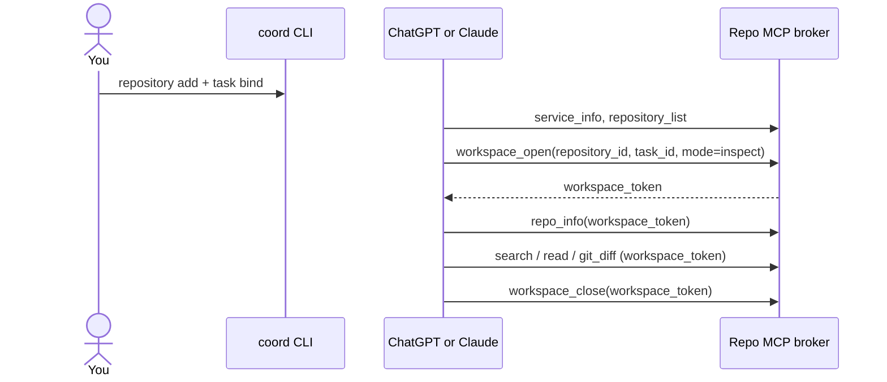
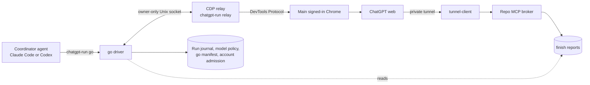

# How Repo MCP works

This page explains the moving parts of Repo MCP and why they exist. For installation,
read [SETUP.md](../SETUP.md). For the normative contract, read
[MULTI-REPO-SPEC.md](MULTI-REPO-SPEC.md).

## The problem

AI clients are good at reading and reviewing code. But giving a cloud chat access to a
local repository usually means one of two bad options:

- copy files into the chat by hand, which is slow and loses context; or
- give an agent a shell, which gives it far more power than a review needs.

Repo MCP is a middle path. It gives the model a small set of file and Git tools. Each
tool call is checked against a repository you approved, a task you started and a policy
you wrote.

## Components

| Component | Role |
| --- | --- |
| **Broker** | A permanent Node.js MCP server on the loopback interface. It serves sixteen tools: bootstrap and repository tools, `finish`, and the `exec` tools (which work only in code workspaces whose grant allows them). It starts with an empty catalog and never needs a restart to switch repositories. |
| **coord CLI** | The operator console. It registers repositories, binds tasks, changes phases, issues write grants and recovers locks. Only you, or an agent you run locally, use it. The model never sees it. |
| **Tunnel client** | OpenAI's official client. It opens an authenticated outbound connection so ChatGPT can reach the loopback broker. Nothing listens on a public port. |
| **`chatgpt-run go`** | The one-shot run driver. A coordinator agent starts it. It drives the owner's main Chrome, runs a ChatGPT pass and records every step in the run journal. See [Driving a ChatGPT run](#driving-a-chatgpt-run-with-go). |
| **State directory** | Owner-only files outside every served repository: policy snapshots, task records, the token signing key, grants, audit logs and request outcomes. |

## Authority in four layers

Every repository tool call must pass all four layers. A mismatch at any layer fails
closed.

1. **Service.** The broker is running and its tool schemas are fixed.
2. **Repository registration.** You approved this checkout with `coord repository add`.
   Repo MCP copies the policy into its own state, so later edits to the source policy
   file do nothing until you register again. Each registration has an epoch.
3. **Task.** You bound a task to the checkout with `coord task bind`. The task records
   the branch, HEAD, policy digest and phase (coding or review). It has a binding epoch
   and a phase epoch. One unfinished task is allowed per checkout. For parallel work on
   one project, register separate Git worktrees.
4. **Workspace.** The model calls `workspace_open` with a repository ID, a task ID and a
   mode. Repo MCP returns a signed `workspace_token`. The token stores all three epochs.

When you disable a repository, change its policy, rebind a task or change its phase, the
matching epoch goes up. Every older token stops working. For example, a coding token
issued before a review cannot become writable again after you resume coding.

## A typical session

For coding, you first run `coord workspace grant --task TASK`. The grant is single-use
and expires in 10 minutes. The model passes it once to `workspace_open` with
`mode=code`. After that, `edit` and `create_file` work inside the policy's write and
create scopes. Each edit must include the file's current hash and a request ID, so a
stale or repeated write fails safely.

## Policies

A policy is a JSON file with read, write and create scopes, dotfile opt-ins, approved
test suites and resource limits. Exclusions always win. Two templates ship with the
project:

- [policy-readonly.json](policy-readonly.json): read everything except build output and
  private state; write nothing.
- [policy-coding.json](policy-coding.json): edit only `src/` and `test/`; no package
  files; no dependency installation.

Some protections apply under every policy: `.git` and VCS metadata, secret-like file
names, Repo MCP state, path traversal, symlinks and hard links.

Discovery also hides untracked files that Git ignores: the repository's `.gitignore`
files, `.git/info/exclude` and a repository-local `core.excludesFile`. Your global Git
excludes are not applied. Repo MCP asks Git for this list when it walks the tree and
checks it twice, so the list and the rule files it came from always match. On later calls
it re-walks as soon as a `.gitignore`, the Git config, the excludes file or the index
changes, so an edit takes effect on the next call. A tracked file stays visible even when
it matches an ignore rule. Two cases are not filtered: policies made of exact file paths
(the operator named each file) and commit-pinned reads and diffs, which show committed
content only.

## Reviews

A review task is a task in the review phase. A `review` workspace is read-only. Repo MCP
supports two review targets:

- **Working review:** compares the live checkout with a base commit.
- **Commit-pinned review:** binds an immutable base and head commit, with an optional
  path scope. The result reports a candidate digest for exactly that range. Use this when
  the branch may move during the review.

Several coordinators (for example Codex and Claude Code) can join one review of the
same target. Each one keeps its own participant, workspace and result.

The bundled skills also include a **coordinated ChatGPT review** flow. The local agent
(Claude Code or Codex) is the coordinator. It starts `chatgpt-run go --kind review`.
`go` prepares or joins the shared review, drives ChatGPT, and records each step in the
durable run journal. ChatGPT performs the review through Repo MCP. Check that this use
fits the terms of the services you use before you enable it. The protocol is in
[SHARED-REVIEW-WORKFLOW.md](SHARED-REVIEW-WORKFLOW.md).

## Driving a ChatGPT run with `go`

`npm run chatgpt-run -- go` runs one ChatGPT pass from start to finish. It supports
three kinds: `architecture`, `review` (commit-pinned only) and `code`. The coordinator
agent prepares the checkout, writes the prompt and starts `go`. It does not drive the
browser and does not poll the page.

How a run goes:

1. **Admission.** The account allows one unresolved ChatGPT run per machine. It also
   limits sends per hour (`--max-per-hour`, default 4). `go` takes the admission before it
   touches the browser.
2. **Browser setup.** `go` connects to the owner's main Chrome through a local relay. The
   relay owns one DevTools connection. Chrome asks the owner to approve it once per Chrome
   start. It needs remote debugging switched on in `chrome://inspect/#remote-debugging`.
   `go` opens its own tab, attaches Repo MCP and pastes the prompt. The prompt starts with a
   `Run <hash>` marker line. For `code`, `go` issues the single-use write grant and appends
   it to the sent text. The grant is never in a prompt file.
3. **Journal.** `go` prepares the run (review: prepare-or-join), selects the effort that
   the model policy requires (profile `architecture`: Pro; `review`: Extra High;
   `code`: High), then observes and reserves the run.
4. **Send once.** `go` writes the send intent before it clicks Send. Recovery never sends
   again. If it cannot tell whether the prompt left, the run stays `uncertain` and the
   account stays held (exit 3). Only `--resume` can continue it.
5. **Wait and save.** `go` waits in code for the finished turn, saves the answer and
   completes the journal. For a review, it first reconciles the participant with the
   workspace ChatGPT opened.
6. **Clean up.** Review closes its participant. Code revokes the workspace (the "seal")
   and then runs the `--check` commands. Last, `go` archives the chat.

`go` prints one JSON line. Exit 0 means cleaned. Exit 3 means the prompt may have been
sent, so only resume. Exit 1 means failure. `--status`, `--resume` and
`--release-admission --reason` complete the interface. The full contract is
[GO-DRIVER-SPEC.md](GO-DRIVER-SPEC.md).

### Finish report

ChatGPT delivers its final report with the `finish` tool: once per workspace, immutable,
at most 192 KiB. A review reports `ship` or `no-ship`. An inspect or code workspace reports
`completed`. `go` uses the report as the run output (`output_source: mcp-report`) and falls
back to the page text. The report is not a completion signal. `go` still waits for the
finished turn. A workspace request ID is single-use. `go` accepts a report only from a
workspace opened after its own send intent.

### Exec path

A code workspace can have the `exec`, `exec_poll` and `exec_cancel` tools. The operator
turns them on when the write grant is issued (`coord workspace grant --exec`, or
`go --exec`). A command runs with `/bin/sh -c` in the checkout, as the owner. There is no
sandbox and no extra worktree. Each task has one command at a time, with a 10 minute
default and a 30 minute maximum, a 4 MiB log and token redaction. Close, revoke, expiry or
shutdown cancels it. This is owner-level trust: a command can escape its process group.
See [EXEC-TOOL.md](EXEC-TOOL.md).

### Seal and checks for code

When a code run ends, `go` revokes the workspace. Then no edit can land. Without `--exec`
this is complete. With `--exec`, `go` first waits until no exec session runs, but an
escaped process can outlive the seal. After the seal, each `--check CMD` runs once in the
checkout with a scrubbed environment. The result reports `checks`, `candidate_changed` and
`sealed`. `go` never commits. The coordinator reviews the answer and the checks, then
commits and pushes.

### Limits

`go` runs on macOS only, and the main Chrome must run with remote debugging on. A change
in the ChatGPT page can break a selector. Then `go` fails before it sends, with a `UI_*`
code. `chatgpt-run probe` checks the page without changing it. Automating the consumer
ChatGPT web page may conflict with its terms. That question is open, and the owner decides.

## What Repo MCP does not do

- It does not run arbitrary commands by default. `run_tests` runs only fixture suites in the policy. The `exec` tools exist only in code workspaces whose grant allowed them.
- It does not commit, push, install dependencies or change policies through MCP.
- It does not call any model API. `go` drives the ChatGPT web page, not an API.
- It does not isolate hostile code. It assumes your user account, your repositories and
  your policies are trusted.
- It does not prove which chat holds a token. Tokens are bearer capabilities.

## Further reading

- [GO-DRIVER-SPEC.md](GO-DRIVER-SPEC.md): the `go` driver contract
- [EXEC-TOOL.md](EXEC-TOOL.md): the exec tools
- [OPERATIONS.md](OPERATIONS.md): operator commands, locks, garbage collection, migration
- [SECURITY.md](../SECURITY.md): threat model and reporting
- [DESIGN-2B-PATH-POLICY.md](DESIGN-2B-PATH-POLICY.md): path policy design
